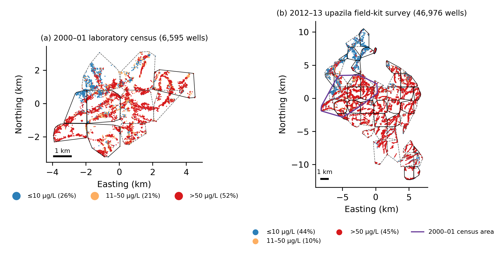
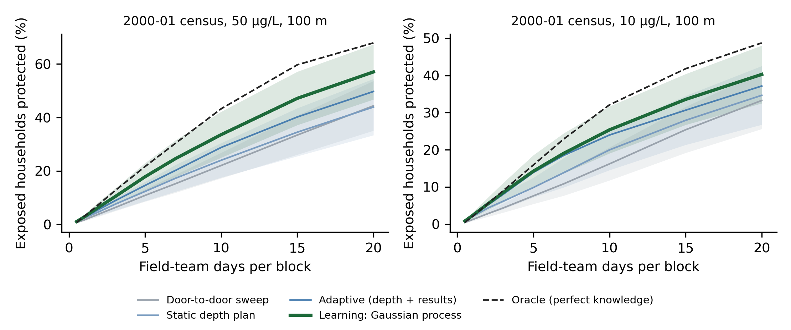
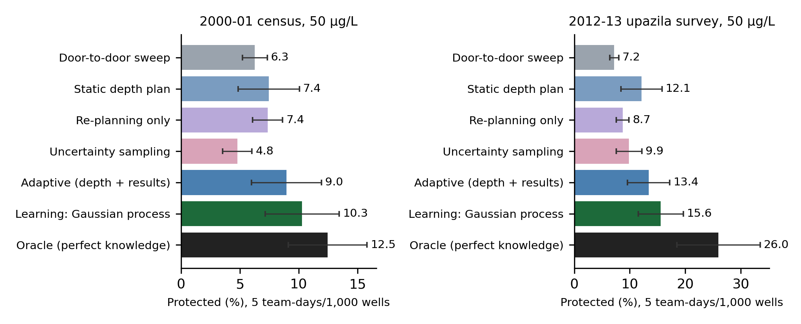
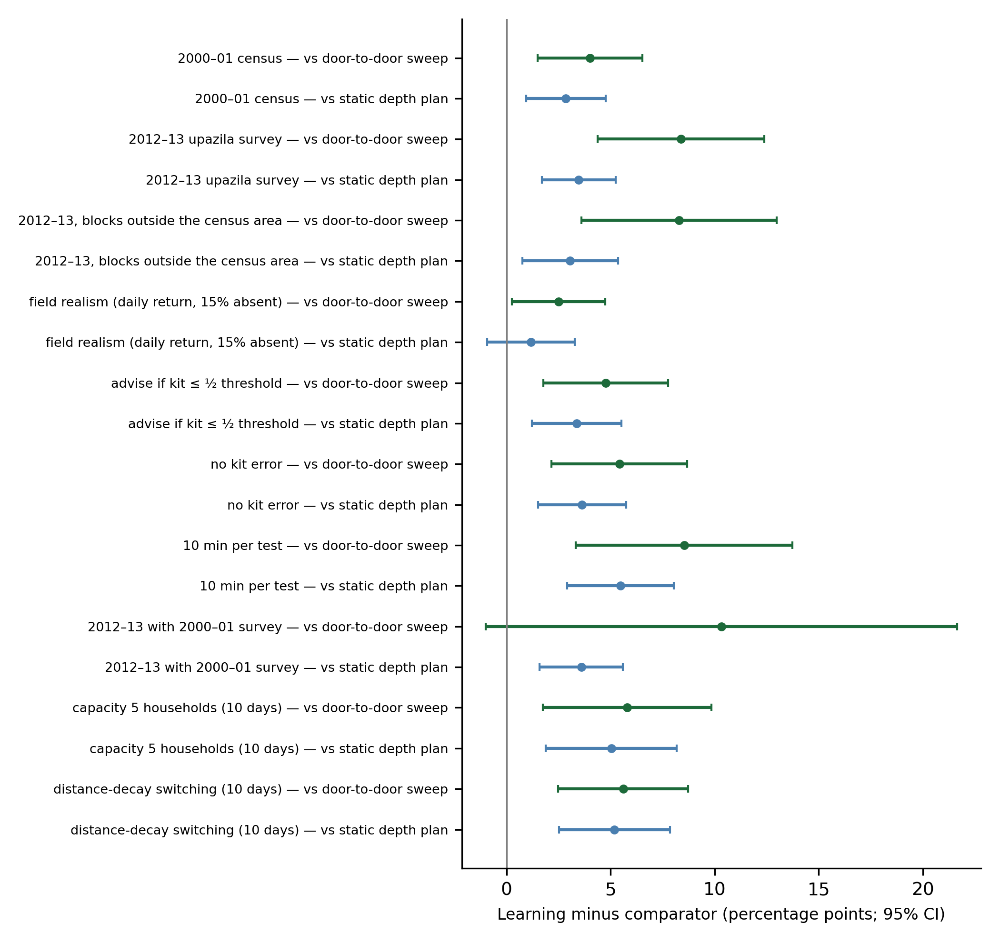

# Abstract

Testing tube wells for arsenic and directing households to nearby safe wells cheaply cuts exposure in Bangladesh, but budgets are limited. Can testing order protect more households? We simulated testing campaigns, with walking time and kit error, on two well surveys in Araihazar upazila, a laboratory census of 6,595 wells (2000-2001) and a field-kit survey of 46,976 wells (2012-2013). A household (one per well) was protected once its unsafe well had been tested and a tested safe well lay within 100 m. A policy that chooses each next well by its expected gain in protected households per minute, updating a Gaussian-process arsenic model after every result, protected 61% (census) and 53% (upazila survey) more exposed households than door-to-door testing for the same effort, and 33-41% more than a depth-based advance plan (Holm-adjusted p ≤ 0.011). Gains were positive in all five census blocks held out from design, though not individually significant against door-to-door testing, and held across 52 blocks of the larger survey, with capacity limits and distance-dependent switching, and over door-to-door testing with daily travel and absent owners. The simulated field cost per person protected fell from US$0.56-0.62 to US$0.35-0.41. Adaptive testing could stretch budgets towards SDG target 6.1.

**Keywords:** arsenic; groundwater; tube wells; field testing; adaptive sampling; active learning; Gaussian process; Bangladesh; SDG 6.1

# 1. Introduction

Arsenic in shallow groundwater remains one of the largest chemical threats to drinking water. In Bangladesh, about 20 million people drank water above the national standard of 50 µg/L in 2009 and about 45 million above the World Health Organization (WHO) guideline of 10 µg/L [@Flanagan2012]. Exposure raises mortality from cancers and cardiovascular disease [@Argos2010; @Naujokas2013], and lower exposure is associated with lower mortality [@Wu2025]. About 24 million people still drank water above 10 µg/L in 2019 [@Pakkos2026], and a preprint estimates a similar number in 2025 [@Hoque2026]; and arsenic-safe water is part of the "safely managed" drinking water targeted by SDG 6.1 [@Bain2018; @Fischer2020].

The cheapest mitigation is information. Arsenic varies sharply between neighbouring wells [@vanGeen2003; @Yu2003], so a household with an unsafe well often has a safe well within walking distance. When wells are tested and labelled, many households switch [@Madajewicz2007; @Opar2007; @vanGeen2019] and exposure falls [@Chen2007; @Huhmann2019]; in Araihazar, testing was the most cost-effective intervention over 18 years [@Jamil2019]. But coverage decays as new wells are installed, households forget results and concentrations change [@George2012b; @vanGeen2014; @Pfaff2017; @Yao2021], and campaigns must be repeated: the 2021-2023 national campaign tested 6.3 million wells, and its authors call for continuous, paid testing [@Khan2025].

With limited budgets, the order of testing matters. Current practice is a door-to-door sweep [@vanGeen2014; @Johnston2007], which is efficient on the road but blind to where safe water is likely. Geostatistical and machine-learning maps predict arsenic [@Gaus2003; @Shamsudduha2015; @Podgorski2020; @Tan2020; @Mehrabi2025; @Zhao2024] and maps and available data sources are proposed to prioritise testing [@Podgorski2020; @Azad2026; @Katner2015], but they rank areas once, before any result is known, and predict concentrations rather than whether an exposed household learns that its well is unsafe and has a safe alternative nearby.

Kit results arrive within minutes [@George2012], so a campaign can learn as it goes. Sequential designs serve related goals: adaptive cluster sampling [@Thompson1990], geostatistical sampling design [@Diggle2006; @Yin2021] and its adaptive form [@Chipeta2016; @Kabaghe2017], including groundwater monitoring [@Lykkegaard2022], active learning and Bayesian optimisation [@Settles2012; @Garnett2012; @Srinivas2012; @Shahriari2016; @Golovin2011], targeted inspections [@Hino2018; @Abernethy2018; @Case2022] and testing-site allocation [@Hsiao2025]. They aim at a precise map, the detection of hazards or access to testing. In private-well programmes, testing has been targeted by fixed rules at households near known high-arsenic wells [@Flanagan2020] or at wells whose earlier results exceed a new standard [@ONeill2023]. Arsenic mitigation depends instead on pairs of wells, because an exposed household is helped only when its own unsafe well is tested and a safe well is found near it. Earlier simulations on Araihazar wells studied switching after every well had been tested [@Gelman2004; @Jameel2021]; to our knowledge, none has chosen the next well to test, updating a model after each result, so as to protect the most exposed households. The two literatures have also developed largely apart: in a Scopus search on arsenic testing or sampling in wells (query in the note to Table A4), we found no record citing the geostatistical design studies [@Diggle2006; @Chipeta2016; @Kabaghe2017].

We answer this question by replaying testing campaigns on two surveys of Araihazar upazila carried out twelve years apart, a laboratory census of 6,595 wells (2000-2001) [@vanGeen2003; @Jameel2021data] and a field-kit survey of 46,976 wells (2012-2013) [@vanGeen2014; @Huang2022; @Knappett2024data]. We compare door-to-door testing and a depth-based advance plan with policies that re-plan after every result, with and without a spatial model of arsenic, and ask how many more exposed households are protected for the same effort, why, under which conditions, at what cost and for whom.

# 2. Materials and Methods

## 2.1. Data

**2000-2001 census.** The public release [@Jameel2021data] (CC BY 4.0) covers about 25 km² of Araihazar upazila, Narayanganj district, with laboratory arsenic, coordinates and depth for 6,605 wells; 10 wells without coordinates were removed and 141 without depth were kept as a separate class. A second file holds 944 wells measured with both an ITS Econo-Quick field kit and in the laboratory [@vanGeen2014; @Jameel2021], which defines the kit-error model. **2012-2013 upazila survey.** The public release [@Knappett2024data] (CC BY 4.0; file Well_Water_Arsenic_Concentration.xlsx, sheet 'Dissolved As Concentration') holds 46,976 of the 48,790 wells tested with the same kit across the upazila (226 km²), with GPS coordinates and owner-reported depth; 1,076 of the 1,187 wells linked by identifier to the census lay within 100 m of their census position. The resource accompanies Huang et al. [@Huang2022] and does not label the survey year; we identify the workbook as the 2012-2013 blanket survey [@vanGeen2014] because it covers the 12 unions of Araihazar, records the kit's reading steps and tester codes, links wells to the census by identifier and holds 46,976 of the 48,790 wells tested. The village summary of the 2000-2005 national survey [@Jamil2019] was used only for context. Each well is treated as one household-equivalent unit (about 8 people [@Jamil2019]), so the outcomes are simulated household-equivalents, not observed households.

## 2.2. Evaluation design

Each area was divided into 2 km × 2 km blocks, merging blocks of fewer than 150 wells into the nearest larger block (Table 1). All design choices (score, look-ahead weights, learner) were made on five randomly chosen census blocks (development blocks) with leave-one-block-out fitting. The other five census blocks (confirmatory blocks) and all 52 upazila blocks were never used for a design choice, and the upazila survey, analysed without re-tuning, is a replication in a larger, later survey with wider spatial coverage (not an external geographical validation, as both surveys are from Araihazar); its 38 blocks outside the census area (fewer than 20 wells within 100 m of a census well) are also reported separately. In the final runs, the blocks of a survey were split at random into halves; the depth prior and the learner were fitted on one half and campaigns were run on the other, in both directions (cross-fitting), so no block was evaluated by a model fitted on its own wells. Splits were repeated (Table 1), and a run fixes the starting well and the kit draws. Each block's result is the mean of its runs. Blocks are the units of inference, because runs and splits average out simulation noise but add no independent observations. Spatial blocking avoids the optimism of random cross-validation [@Tziachris2023]; Table A4 gives the design history.

**Table 1.** Data and evaluation design.

| Item | 2000-2001 census | 2012-2013 upazila survey |
|---|---|---|
| Wells; area | 6,595; about 25 km² | 46,976; 226 km² |
| Wells above 50 µg/L | 52% | 45% |
| True arsenic | laboratory value | laboratory value imputed from 944 kit-laboratory pairs |
| What a team observes | kit reading drawn from the 944 pairs | recorded kit reading |
| Model inputs | coordinates, depth class, results so far | as census (owner-reported depth) |
| Blocks (2 km) | 10 of 370-1,203 wells (5 development, 5 confirmatory) | 52 of 151-2,639 wells (38 outside the census area) |
| Runs per block | 5 splits × 4 runs | 2 splits × 3 runs |
| Role | design and evaluation | replication without re-tuning |

## 2.3. Campaign simulator and outcomes

A field team starts at a random well in a block and tests wells in the order chosen by its policy. Walking time is the straight-line distance × 1.3 at 3 km/h; each test takes 20 minutes on site [@George2012; @vanGeen2019]; a team-day has 360 minutes. In this idealised setting teams tested 16-17 wells per day, more than the 12 per day reported in the field [@vanGeen2014]; a field-calibrated scenario with about 12 tests per day and a field-realism scenario are reported in Section 2.6. Kit readings (census) and laboratory values (upazila survey) are drawn from the 944 pairs as in Table 1 and Appendix A [@Jameel2021].

A household is **exposed** if its own well is truly unsafe (>50 µg/L, or >10 µg/L). It is **protected** once its own well has been tested and read unsafe and a tested well within *r* = 100 m (50 and 200 m in sensitivity analyses [@Opar2007; @Jameel2021]) has read safe and is truly safe. It is **misled** if its own unsafe well read safe or every well it was directed to is unsafe; a **false alarm** is a safe well that read unsafe. Two further outcomes relax the switching assumption. One limits each safe well to five households (**capacity**; households assigned nearest first, with a maximum-flow assignment as a check), and the other gives **expected switching** with a probability of exp(-*d*/83 m) (0.3 at 100 m [@Jameel2021]).

The **primary endpoint** is the share of exposed households protected after 5 team-days per 1,000 wells (normalising effort by block size), at 50 µg/L and 100 m; fixed horizons (5, 10, 20 days) are secondary. The estimated field cost per person protected is the cost of the field effort divided by the persons counted as protected in the simulation; it is not a cost per observed switch or per unit of exposure averted. The headline costing prices field time at US$28.80 per team-day, the all-in cost (labour, supervision, supplies and placard) of the 12 tests one tester completed per day in Araihazar at US$2.40 each [@vanGeen2014; @Jamil2019]; because labour dominates, a team that tests more wells costs the same per day. Two alternatives add US$0.17 of kit consumables per test [@George2012] or charge US$2.40 for every test performed (Appendix A). Transport, training, smartphones and programme management are excluded. Equity is protection by within-block tertile of the share of safe wells within 200 m.

## 2.4. Testing policies

A test that reads unsafe informs its household, which is protected at once if a safe well is known nearby; a test that reads safe creates a source for informed neighbours. Targeted policies choose the next well *j* by the expected gain in protected households per minute,

$$ g_j = \frac{p_j\,(E_j + \lambda U_j) + (1-p_j)\,(S_j + \lambda Q_j)}{t_\text{test} + t_\text{walk}(j)}, $$

where $g_j$ is the score, $p_j$ the probability that well *j* is safe and $N(j)$ the set of wells within *r* of *j*. Each household *i* is in one of three states: its well is untested ($\mathrm{unt}_i = 1$); its well has been tested and read safe; or its well has been tested and read unsafe, so the household is informed ($\mathrm{inf}_i = 1$). An informed household is protected once a well within *r* has also read safe and is truly safe. Let $c_i$ be the probability that household *i* already has such a source, that is, a tested well within *r* that read safe ($c_i = 1$ once one exists; the static plan, which ignores results, computes it from the $p_k$ of tested wells). A safe reading at *j* protects the informed households near it that have no source, $E_j = \sum_{i \in N(j)} \mathrm{inf}_i (1 - c_i)$, and gives a source to untested, probably unsafe neighbours, $U_j = \sum_{i \in N(j), i \neq j} \mathrm{unt}_i (1 - c_i)(1 - p_i)$. An unsafe reading informs the household of *j*, which is protected at once if it already has a source, with probability $S_j = c_j$, or later if an untested neighbour proves safe, with probability $Q_j = 1 - \prod_{i \in N(j), i \neq j, \mathrm{unt}_i = 1} (1 - p_i)$. $U_j$ and $Q_j$ are look-ahead terms weighted by $\lambda$. A household with a source has $c_i = 1$ and drops out of $E_j$ and $U_j$, so it is never counted twice. Policies differ in what they know (Algorithm 1; details in Appendix A):

- **Door-to-door sweep:** nearest untested well (current practice [@vanGeen2014]).
- **Static plan:** $p_j$ from depth; earlier results replaced by their expectations.
- **Re-planning only:** one $p_j$ for all wells, with observed results.
- **Uncertainty sampling:** maximise $p_j(1-p_j)$ × untested neighbours per minute.
- **Adaptive:** $p_j$ from depth, with observed results.
- **Learning:** as adaptive, with $p_j$ updated after every result by a learner (Section 2.5).
- **Oracle:** $p_j$ equal to the true status (perfect-knowledge reference).

$\lambda$ was tuned on the development blocks for the static, re-planning, adaptive and learning policies (static 0.05; the others 0.1); the oracle used 0.1. All policies share each run's starting well and kit draws, so comparisons are paired.

**Algorithm 1.** One testing campaign in a block under a targeted policy.

1. Fit the depth prior and the learner on the other half of the blocks; start the team at a random well (at the base well under field realism).
2. For every untested well *j*, compute $p_j$ (from depth, from the learner given all results so far, or a constant, depending on the policy), then $E_j$, $S_j$, $U_j$, $Q_j$ and the score $g_j$ with the walking time from the team's position (Equation 1).
3. Walk to the well with the highest score and test it (20 min); the kit reading is known at once.
4. If it reads unsafe, inform its household; if it reads safe, mark it as a source for every household within *r*. Add the reading to the learner's data.
5. Repeat steps 2-4 until the effort is spent, recording the outcomes at fixed marks.

## 2.5. Learning models

Learners predict the probability that an untested well is safe from depth and the results so far. Arsenic values are expressed as $y = \log_{10} \max(\mathrm{As}, 1)$, so laboratory values below 1 µg/L and kit readings of 0 (38% of upazila readings) are set to 1 µg/L ($y = 0$). Deep (>100 ft) and shallow wells (including those of unknown depth) are separate layers that do not inform each other [@vanGeen2003]. A depth prior gives the mean $m$ and standard deviation $\sigma$ of $y$ in seven classes (<30, 30-50, 50-70, 70-100, 100-150 and ≥150 ft, and unknown), estimated on the fitting half; without results, $p_j = \Phi((\log_{10} T - m_j)/\sigma_j)$ for threshold *T*. The headline learner is a **Gaussian process** (simple kriging) of the residual $z = y - m$ with covariance $C(h) = \sigma_s^2 \exp(-h/\rho)$ between wells *h* metres apart (planar coordinates, not standardised) and a nugget $\tau^2$ for variation between neighbouring wells at scales below their spacing and, when the model is fitted to kit readings, kit error. For an untested well *j* and the vector $\mathbf{z}_t$ of residuals at the tested wells of its layer, with covariance matrix $\mathbf{K}$ and covariances $\mathbf{k}_j$ to *j*, the posterior mean and variance are $\mu_j = \mathbf{k}_j^{\top} (\mathbf{K} + \tau^2 \mathbf{I})^{-1} \mathbf{z}_t$ and $v_j = \sigma_s^2 - \mathbf{k}_j^{\top} (\mathbf{K} + \tau^2 \mathbf{I})^{-1} \mathbf{k}_j$, and $p_j = \Phi((\log_{10} T - m_j - \mu_j)/(\sigma_j \sqrt{(v_j + \tau^2)/(\sigma_s^2 + \tau^2)}))$, which equals the prior when no nearby well has been tested. Sill, range and nugget were fitted by maximum likelihood (scikit-learn 1.8) on 1,500 shallow wells drawn at random from the fitting half, once per fitting half, and reused across the campaign replicates of that split ($\sigma_s^2 = 0.20$, $\rho = 283$ m and $\tau^2 = 0.13$ on the census development half). The subsample keeps the cubic cost of exact fitting small, and shallow wells are used because they make up 84% of census wells and include most unsafe wells; deep wells (82% safe at 50 µg/L) use the same parameters, a simplification that matters little because their probabilities stay close to the high prior. In a campaign the Gaussian process is conditioned on the kit readings of tested wells, transformed in the same way; in the census it is fitted to laboratory values and in the upazila survey to the recorded kit readings. Kit error is not modelled separately: the upazila nugget includes it, the census nugget does not. Sensitivity analyses added the kit-error variance of the 944 pairs (0.11 in squared $\log_{10}$ units) to the census nugget, or set kit readings of 0 to 5 µg/L, half the lowest non-zero category. k-nearest neighbours, random forest and LightGBM were also compared (Table A2).

## 2.6. Further scenarios

In the census we varied one condition at a time: **field realism** (each day starts and ends at a base well, with the walk back inside the 360-minute day; 15% of visits fail because the owner is absent, and the well is retried later); **field-calibrated productivity** (29 minutes per test, about 12 tests per day; also in the upazila survey); a **conservative rule** declaring a well safe only if the kit reads at most half the threshold (all policies); no kit error; radius 50 and 200 m; wells thinned to 50% and 25%; and 10 minutes per test. In the upazila survey, a **re-testing** scenario gave the static, adaptive and learning policies the 2000-2001 values of linked wells (1,064 links in 11 blocks), as calibrated probabilities of being safe now (not as Gaussian-process observations); those wells still had to be re-tested. Three further analyses checked the evaluation (Appendix A): a 600 m exclusion buffer between fitting and evaluated wells, a bootstrap of the 944 kit-laboratory pairs for the imputed upazila truth, and the calibration of the predicted probabilities on held-out blocks.

## 2.7. Statistical analysis

Blocks are the units of inference. For each comparison we report the mean paired difference over blocks with a 95% *t*-interval and paired *t*-test, the blocks with a positive difference and the well-weighted (pooled) share. The primary family (learning versus door-to-door, static and adaptive, in both surveys) was declared before the final runs and Holm-adjusted; other analyses are secondary. As checks on a *t*-test over few blocks, the primary comparisons were also tested by a paired sign-flip permutation test (exact in the census; otherwise 200,000 random sign patterns with $p = (b + 1)/(B + 1)$) and a Wilcoxon signed-rank test, with each block left out in turn, and with the upazila blocks aggregated into 17 super-blocks of 4 km × 4 km to allow for spatial dependence; the Monte Carlo error of each block's mean was compared with the spread between blocks (Appendix A). Analyses used Python 3.14, NumPy, SciPy, scikit-learn 1.8 and LightGBM 4.6. During the preparation of this study, the authors used Claude Opus 5.5 (Anthropic) to assist with code, analysis and drafting. The authors have reviewed and edited the output and take full responsibility for the content of this publication.

# 3. Results

## 3.1. The wells

In the census, 52% of wells exceeded 50 µg/L and 74% exceeded 10 µg/L, yet safe and unsafe wells were interleaved. The median well had 18 others within 100 m, and 90% had a safe well within 100 m (Figure 1). Wells shallower than 30 ft or deeper than 100 ft were more often safe. The upazila survey was denser (median 32 wells within 100 m; 45% above 50 µg/L and 56% above 10 µg/L).

## 3.2. Learning where to test protects more exposed households

For the same effort of 5 team-days per 1,000 wells, the learning policy protected 10.3% of exposed households per block in the census and 15.6% in the upazila survey, more than door-to-door testing, the static plan and the adaptive policy in both (Table 2; Holm-adjusted *p* ≤ 0.011). Over the whole area, it protected 61% and 53% more exposed households than door-to-door testing, 41% and 33% more than the static plan and 17% and 20% more than the adaptive policy. The ten-block census estimate mixes development and confirmatory blocks; in the five confirmatory blocks, secondary evidence, the gains were positive in every block (Table 2), but with five blocks the smallest attainable two-sided permutation *p* is 0.0625. Permutation and Wilcoxon tests agreed (Holm-adjusted *p* ≤ 0.010), leaving out any one census block kept the gains within 3.3-4.4, 2.3-3.3 and 1.2-1.4 points, the gains held over the 17 upazila super-blocks (permutation *p* ≤ 0.002), and simulation noise was small against the spread between blocks (Table A5, Figure A1). The advantage grew with effort (Figure 2). After ten team-days the learning policy had protected 33.6% of exposed households in the census (door-to-door 22.0%, static 24.0%, adaptive 28.8%; 10/10 blocks) and 37.0% in the upazila survey (21.5%, 28.6%, 32.0%; 45-50/52 blocks).

**Table 2.** Primary endpoint. Exposed households protected (%) after 5 team-days per 1,000 wells (50 µg/L, 100 m), mean over blocks; paired difference (percentage points, 95% *t*-interval); *p*, Holm-adjusted over the six primary comparisons, except in the confirmatory rows, which are secondary and give the unadjusted paired *t*-test; blocks favouring learning; relative gain in the well-weighted share.

| Survey | Comparator | Comparator (%) | Learning (%) | Difference (95% CI) | *p* | Blocks | Relative gain |
|---|---|---|---|---|---|---|---|
| 2000-01 census | Door-to-door sweep | 6.3 | 10.3 | 4.0 (1.5, 6.5) | 0.011 | 10/10 | +61% |
| | Static depth plan | 7.4 | 10.3 | 2.8 (0.9, 4.8) | 0.011 | 9/10 | +41% |
| | Adaptive | 9.0 | 10.3 | 1.3 (0.9, 1.8) | 0.001 | 10/10 | +17% |
| Census, 5 confirmatory blocks (secondary, unadjusted *p*) | Door-to-door sweep | 5.9 | 10.3 | 4.5 (-0.1, 9.0) | 0.052 | 5/5 | +71% |
| | Static depth plan | 6.1 | 10.3 | 4.2 (1.0, 7.5) | 0.023 | 5/5 | +71% |
| | Adaptive | 9.2 | 10.3 | 1.1 (0.3, 1.9) | 0.021 | 5/5 | +14% |
| 2012-13 upazila | Door-to-door sweep | 7.2 | 15.6 | 8.4 (4.4, 12.4) | 0.001 | 44/52 | +53% |
| | Static depth plan | 12.1 | 15.6 | 3.5 (1.7, 5.2) | 0.001 | 39/52 | +33% |
| | Adaptive | 13.4 | 15.6 | 2.2 (0.8, 3.6) | 0.008 | 40/52 | +20% |

The estimated field cost per person protected in the simulation was US$0.35 under the learning policy in the census (adaptive US$0.41, static US$0.49, door-to-door US$0.56) and US$0.41 in the upazila survey (US$0.49, US$0.55, US$0.62). Learning stayed the cheapest under both alternative costings, and its lead grew when every test was charged (US$0.47 against US$0.80 for door-to-door testing in the census), because its teams walked further and tested slightly fewer wells per day (16.2 against 17.2; Table A6). At about 12 tests per day it cost US$0.50 and US$0.63 against US$0.89 and US$0.92. At 10 µg/L, the learning policy protected 3.8 and 4.1 points more than door-to-door testing (95% CI 2.0-5.5; 2.4-5.8) and 2.2 and 2.3 more than the static plan (0.6-3.8; 1.3-3.4) in the two surveys; its lead over the adaptive policy was 0.5 (-0.1 to 1.1) and 1.4 (0.5-2.2) points (Table A1).

## 3.3. Where the gain comes from

Re-planning without any information on where safe water is likely protected no more than the static plan (7.4% vs 7.4% in the census; 8.7% vs 12.1% in the upazila survey; Figure 3). Adding depth (adaptive) raised protection to 9.0% and 13.4%, and a spatial model updated with every result to 10.3% and 15.6%. The gain therefore needs both feedback and prediction. Uncertainty sampling protected 4.8% and 9.9%, 5.5-5.7 points fewer than learning, so a rule that sharpens the map protects few households. All four learners performed alike (Gaussian process ahead by ≤0.6 points, not significant; Table A2). The oracle protected 12.5% and 26.0%, showing room for better prediction.

## 3.4. Replication across the upazila

The larger upazila survey, with wider spatial coverage, replicated the census result without re-tuning (Table 2, Figure 4). In the 38 blocks outside the census area, the learning policy protected 8.3 points more than door-to-door testing (3.6-13.0; 31/38 blocks), 3.1 more than the static plan (0.8-5.4) and 2.2 more than the adaptive policy (0.3-4.1). Knowing the 2000-2001 values of linked wells changed any policy's protection after ten days by at most 1.1 points (learning 0.3 points lower) and, at the primary effort, narrowed learning's lead over the static plan in those 11 blocks from 4.7 to 3.3 points (1.3-5.3; 10/11 blocks).

## 3.5. Robustness

With each day starting and ending at a base well and 15% of owners absent (12.5-14 tests per day), the learning policy protected 2.3 points more than door-to-door testing at the primary effort (0.2-4.4) and 1.1 more than the static plan (-0.8 to 2.9, not significant); after ten days it protected 26.3% against 18.3%, 20.2% and 22.7% for door-to-door, static and adaptive (8-9/10 blocks). At about 12 tests per day, its gains at the primary effort were 3.4 (1.0-5.8), 1.3 (-0.1 to 2.8) and 0.8 (0.3-1.3) points in the census and 6.3 (2.9-9.7), 2.5 (1.1-3.8) and 1.8 (0.6-2.9) points in the upazila survey. With a capacity of five households per safe well, it protected 5.8 and 5.0 points more than door-to-door and static after ten days in the census and 10.8 and 6.3 more in the upazila survey; an optimal assignment protected 1-2 points more under each policy and gave similar gains (Table A1). With distance-dependent switching, 19.7% of exposed households were expected to switch under learning against 14.1% and 14.5% (census), and 23.9% against 15.6% and 18.5% (upazila). The gain over door-to-door testing also held at radii of 50 and 200 m, without kit error, with 10-minute tests and in thinned networks; the gain over the static plan was positive in all these cases and significant in all but the 200 m radius at the primary effort (1.2, -1.1 to 3.5; Table A1; selected analyses in Figure 5). When most wells in a small block are tested, policies converge. Setting kit readings of 0 to 5 µg/L, adding the kit-error variance to the census nugget, or excluding fitting wells within 600 m of evaluated wells changed the learning policy's protection at the primary effort by at most 0.10 points and its gains over the three comparators by at most 0.38 points; at 50 µg/L all gains remained significant (Table A7). In 20 bootstrap replicates of the kit-laboratory pairs, the upazila gains were positive in every replicate (2.5-97.5 percentiles 7.1-9.7, 2.9-5.0 and 1.4-3.6 points; Table A8). On held-out blocks, the Gaussian-process probabilities had lower Brier scores than the depth prior in every setting (0.08-0.23 against 0.10-0.26), but in the census at 10 µg/L they under-predicted the share of safe wells by up to 0.22 (Table A9, Figure A2).

## 3.6. Kit errors

After ten days at 50 µg/L in the census, 4.4% of exposed households were misled under learning (2.1% by a false-safe own well, 2.4% by false-safe sources), 3.9% under the static plan and 3.7% under door-to-door testing; false alarms affected 4.5-5.5% of households with safe wells under all non-oracle policies. Declaring a well safe only when the kit read ≤25 µg/L cut misled households under learning to 0.8% while protection stayed at 32.3% (Figure 6); door-to-door testing under the same rule protected 20.0% (0.45% misled), 12.3 points fewer (6.0-18.7; 10/10 blocks). The rule raises false alarms, from 4.6% to 11.0% under learning (12.8% door-to-door) at 50 µg/L and from 8.7% to 24.3% at 10 µg/L, where protection fell from 25.4% to 21.5%.

## 3.7. Who is reached

At 50 µg/L, in the third of locations with the fewest safe wells, the learning policy protected 32.9% of exposed households after ten days in the census (static 16.0%; difference 16.9, 9.4-24.3) and 40.0% in the upazila survey (static 27.3%; 12.7, 9.2-16.2). In the third with the most safe wells it protected fewer than the static plan (9.3 points fewer, 0.8-17.9, in the census; 5.8 fewer, 1.1-10.6, in the upazila survey) and, in the upazila survey, than door-to-door testing (7.9 fewer, 4.6-11.1). At 10 µg/L the gain over the static plan in the worst-served third was 3.1 (0.3-6.0) and 9.9 (6.9-12.8) points with no loss in the best-served third (Table A3).

# 4. Discussion

In two surveys of one upazila, twelve years apart, choosing each well by its expected gain in protected households per minute and updating a Gaussian-process model after every result protected 53-61% more exposed households than door-to-door testing and 33-41% more than a depth-based plan for the same simulated effort, at about two-thirds of the estimated field cost per person protected. The gains survived Holm correction and permutation and rank tests. The strongest evidence is the 52-block upazila survey, analysed without re-tuning (though from the same upazila); the census estimate mixes development and confirmatory blocks, and the five confirmatory blocks confirm the direction of the gains but not, on their own, their significance against door-to-door testing. The gains held under capacity limits, distance-dependent switching, both thresholds, other radii, about 12 tests per day, alternative imputed truths and, against door-to-door testing, daily travel with absent owners.

The gain combines feedback with prediction. Protection needs two tests: of a household's own well, to inform it, and of a nearby safe well, to give it somewhere to go. Door-to-door testing does the first everywhere but finds safe wells by chance; a static map points to likely safe wells but cannot follow up; uncertainty sampling sharpens the map but protects few households. The learning policy finds likely safe wells and then tests the unsafe wells around them. Four learners gave the same result, so the benefit lies in the decision rule rather than the algorithm.

The policy also reached first the households with the fewest safe wells nearby, about doubling their protection relative to the static plan in the census (Section 3.7), because the objective values a safe well by the unprotected households around it. The local share of safe wells is a proxy for access to safe alternatives; income, vulnerability, willingness to walk and switching were not observed, so this is not evidence of socioeconomic equity, which a field trial could assess.

Earlier work studied switching after blanket testing [@Gelman2004; @Jameel2021] or took blanket testing as given [@Jamil2019], and private-well programmes have targeted testing by fixed rules [@Flanagan2020; @ONeill2023]; we choose each next well from the results so far. The rule is a one-step greedy policy of the kind studied in adaptive submodular optimisation [@Golovin2011], related to adaptive cluster sampling [@Thompson1990] and active search [@Garnett2012], but its objective is defined by pairs of wells. Static risk maps [@Podgorski2020; @Azad2026] are represented, in simplified form, by the depth-based plan, and variance-driven designs [@Chipeta2016; @Kabaghe2017] by uncertainty sampling; both protected fewer households.

The policy needs a list of wells with location and depth, which the 2021-2023 national campaign created for 6.3 million wells [@Khan2025], and a smartphone that re-ranks wells after each test. Araihazar's conditions are common: in the 2000-2005 national survey, 68.5% of wells nationally and 67.7% in Araihazar's villages met the standard, and 55% of 1.25 million unsafe wells were in villages where at least a fifth of wells were safe [@Jamil2019]. A conservative advice rule keeps misled households below 1% at the cost of more false alarms. Because protection depends on behaviour [@Opar2007; @Madajewicz2007; @Pfaff2017], a cluster-randomised field trial of testing order, measuring switching and urinary arsenic [@Chen2007], is the next step.

Limitations: the results are simulated. They count exposed household-equivalents (one per well) that would learn of a nearby safe well, not observed households or reductions in exposure, which depend on switching and on owners sharing their wells [@Opar2007; @Madajewicz2007]. Each well is one unit of households and travel is straight-line walking with a detour factor; the capacity, switching and field-realism analyses relax but cannot replace field conditions. In the upazila survey, laboratory values were imputed from kit readings, and the two surveys partly overlap and come from one upazila, although one spanning 226 km² and a wide range of arsenic levels. The main analysis assumes 16-17 tests per team-day; at the field rate of about 12 the gains were smaller in the census but persisted. The cost is a field cost per simulated person protected, not a programme cost: teams would also need offline maps, training, software and supervision, and households visited later may object.

# 5. Conclusions

In simulated campaigns, choosing each next well by its expected gain in protected households, and updating a spatial model of arsenic after every result, protected 53-61% more exposed households than door-to-door testing for the same field effort in two Bangladeshi well surveys, at about two-thirds of the estimated field cost per person protected, and reached households with the fewest safe options sooner and those with many safe options later. The rule could run on the smartphones already used in national campaigns and can help stretch testing budgets towards SDG target 6.1.

# Author Contributions

Conceptualization, M.M.I.; methodology, M.M.I.; software, M.M.I.; formal analysis, M.M.I.; validation, A.Y. and N.K.; writing-original draft preparation, M.M.I.; writing-review and editing, M.M.I., A.Y. and N.K.; supervision, A.Y. and N.K. All authors have read and agreed to the published version of the manuscript.

# Funding

This research received no external funding.

# Institutional Review Board Statement

Not applicable. The study uses publicly available data on tube wells without personal identifiers; no human participants were involved.

# Informed Consent Statement

Not applicable.

# Data Availability Statement

The data are openly available on HydroShare: the 2000-2001 census and kit-laboratory pairs (doi:10.4211/hs.8e1373d87419447c945625af13f0a2ea) and the 2012-2013 upazila survey (doi:10.4211/hs.48e779d1aeac49609e3077625092e31b), both CC BY 4.0; the national village summary is in the Supporting Information of Jamil et al. [@Jamil2019]. The simulation code, configuration files and all results are openly available on GitHub (https://github.com/Islam-DS/arsenic-adaptive-testing) and archived on Zenodo (doi:10.5281/zenodo.24578227) [@Islam2026code].

# Acknowledgments

The authors thank A. van Geen, Y. Jameel, P. Knappett, K. M. Ahmed and colleagues for making the Araihazar data openly available.

# Conflicts of Interest

The authors declare no conflicts of interest.

# Abbreviations

The following abbreviations are used in this manuscript:

- CI: confidence interval
- LightGBM: light gradient-boosting machine
- SDG: Sustainable Development Goal
- WHO: World Health Organization

# References
