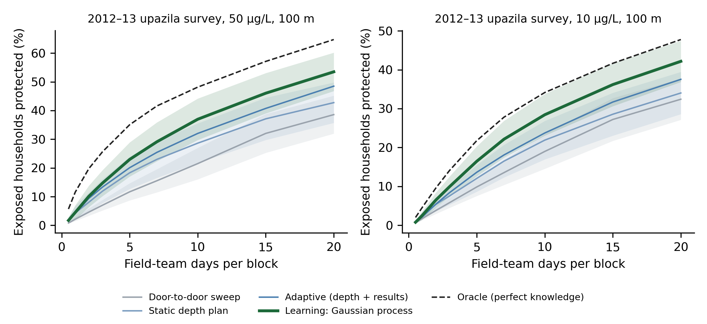
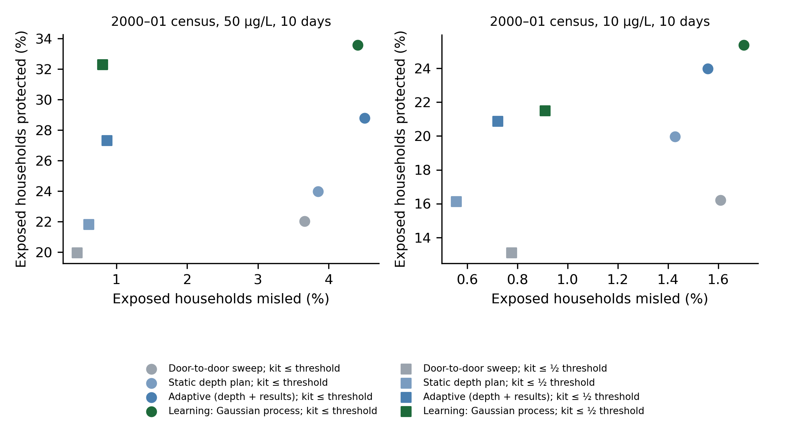

# Abstract

Testing tube wells for arsenic and directing households with unsafe wells to nearby safe ones cheaply cuts exposure in Bangladesh, but budgets are limited. We asked whether testing order can protect more exposed households for the same effort. We replayed testing campaigns, including walking time and field-kit error, on two surveys of tube wells in Araihazar upazila, a laboratory census of 6,595 wells (2000-2001) and a field-kit survey of 46,976 wells (2012-2013). A household counted as protected once its own unsafe well had been tested and a safe tested well was within 100 m. A policy that chooses each next well by its expected gain in protected households per minute, updating a Gaussian-process model of arsenic after every result, protected 61% (census) and 53% (upazila survey) more exposed households than door-to-door testing for the same effort, and 33-41% more than an advance plan based on well depth; all six primary comparisons were significant after Holm correction. Gains over door-to-door testing persisted with daily travel and absent owners, and over both comparators after ten days with capacity limits and distance-dependent switching; the cost per person protected fell from US$0.56-0.62 to US$0.35-0.41. Adaptive testing could stretch testing budgets towards SDG target 6.1.

**Keywords:** arsenic; groundwater; tube wells; field testing; adaptive sampling; active learning; Gaussian process; Bangladesh; SDG 6.1

# 1. Introduction

Arsenic in shallow groundwater remains one of the largest chemical threats to drinking water. In Bangladesh, about 20 million people drank water above the national standard of 50 µg/L in 2009 and about 45 million above the World Health Organization (WHO) guideline of 10 µg/L [@Flanagan2012]. Exposure raises mortality from cancers and cardiovascular disease [@Argos2010; @Naujokas2013], and lower exposure is associated with lower mortality [@Wu2025]. An estimated 24-26 million people still drank water above 10 µg/L in 2019-2025 [@Pakkos2026; @Hoque2026], and arsenic-safe water is part of the "safely managed" drinking water targeted by SDG 6.1 [@Bain2018; @Fischer2020].

The cheapest mitigation is information. Arsenic varies sharply between neighbouring wells [@vanGeen2003; @Yu2003], so a household with an unsafe well often has a safe well within walking distance. When wells are tested and labelled, many households switch [@Madajewicz2007; @Opar2007; @vanGeen2019] and exposure falls [@Chen2007; @Huhmann2019]; in Araihazar, testing was the most cost-effective intervention over 18 years [@Jamil2019]. But coverage decays as new wells are installed, households forget results and concentrations change [@George2012b; @vanGeen2014; @Pfaff2017; @Yao2021], and campaigns must be repeated: the 2021-2023 national campaign tested 6.3 million wells, and its authors call for continuous, paid testing [@Khan2025].

With limited budgets, the order of testing matters. Current practice is a door-to-door sweep [@vanGeen2014; @Johnston2007], which is efficient on the road but blind to where safe water is likely. Geostatistical and machine-learning maps predict arsenic [@Gaus2003; @Shamsudduha2015; @Podgorski2020; @Tan2020; @Mehrabi2025; @Zhao2024] and maps and available data sources are proposed to prioritise testing [@Podgorski2020; @Azad2026; @Katner2015], but they rank areas once, before any result is known, and predict concentrations rather than whether an exposed household learns that its well is unsafe and has a safe alternative nearby.

Kit results arrive within minutes [@George2012], so a campaign can learn as it goes. Sequential designs have been developed for related goals. They include adaptive cluster sampling [@Thompson1990], geostatistical sampling design [@Diggle2006; @Yin2021] and its adaptive form [@Chipeta2016; @Kabaghe2017], the choice of the next groundwater monitoring well [@Lykkegaard2022], active learning, active search and Bayesian optimisation [@Settles2012; @Garnett2012; @Srinivas2012; @Shahriari2016], greedy adaptive policies [@Golovin2011], data-driven targeting of inspections [@Hino2018; @Abernethy2018], adaptive inspection for disease vectors [@Case2022] and adaptive allocation of testing sites [@Hsiao2025]. Their aim is a precise map, the detection of hazards or access to testing. In private-well programmes, testing has been targeted by fixed rules at households near known high-arsenic wells [@Flanagan2020] or at wells whose earlier results exceed a new standard [@ONeill2023]. Arsenic mitigation depends instead on pairs of wells, because an exposed household is helped only when its own unsafe well is tested and a safe well is found near it. Earlier simulations on Araihazar wells studied switching after every well had been tested [@Gelman2004; @Jameel2021]; to our knowledge, none has chosen the next well to test, updating a model after each result, so as to protect the most exposed households. The two literatures have also developed largely apart. Of 5,212 Scopus records with reference lists retrieved by a search on arsenic testing or sampling in wells (1995-2026, searched November 2026; query in Table S4 note), none cites the geostatistical design studies of Diggle and Lophaven, Chipeta et al. or Kabaghe et al. [@Diggle2006; @Chipeta2016; @Kabaghe2017].

We answer this question by replaying testing campaigns on two surveys of Araihazar upazila carried out twelve years apart, a laboratory census of 6,595 wells (2000-2001) [@vanGeen2003; @Jameel2021data] and a field-kit survey of 46,976 wells (2012-2013) [@vanGeen2014; @Huang2022; @Knappett2024data]. We compare door-to-door testing and a depth-based advance plan with policies that re-plan after every result, with and without a spatial model of arsenic, and ask how many more exposed households are protected for the same effort, why, under which conditions, at what cost and for whom.

# 2. Materials and Methods

## 2.1. Data

**2000-2001 census.** The public release [@Jameel2021data] (CC BY 4.0) covers about 25 km² of Araihazar upazila, Narayanganj district (convex hull 35 km²) and contains 6,605 wells with laboratory arsenic, coordinates and depth; 10 wells without coordinates were removed, and 141 wells without depth were kept as a separate class. A second file holds 944 wells measured with both an ITS Econo-Quick field kit (categories 0-1000 µg/L) and in the laboratory [@vanGeen2014; @Jameel2021]; it defines the kit-error model.

**2012-2013 upazila survey.** The public release [@Knappett2024data] (CC BY 4.0) contains 46,976 of the 48,790 wells tested with the same kit across the upazila (226 km²), with GPS coordinates and owner-reported depth and no personal identifiers. Of 1,187 wells linked by identifier to the census, 1,076 links whose recorded positions were within 100 m were retained.

**National context.** The village summary of the 2000-2005 national survey (3.96 million wells, 44,865 villages) [@Jamil2019] was used only for context. Each well is treated as one unit of households (about 8 people per well [@Jamil2019]).

## 2.2. Evaluation design

Each area was divided into 2 km × 2 km blocks, merging blocks of fewer than 150 wells with the nearest larger block: 10 census blocks (370-1,203 wells) and 52 upazila blocks (151-2,639 wells). Fourteen upazila blocks overlap the census area (at least 20 wells within 100 m of a census well); the other 38 are also reported separately, as declared before the final runs. All design choices (score, look-ahead weights, learners) were made on one random half of the census blocks with leave-one-block-out fitting; results for the other five blocks alone are also reported. Models were then fitted on one half of the blocks and evaluated on the other, in both directions (cross-fitting), over 5 random splits (census) and 2 (upazila); each block's result is the mean over splits and runs. Spatial blocking avoids the optimism of random cross-validation [@Tziachris2023]. Table S4 gives the design history.

## 2.3. Campaign simulator and outcomes

A field team starts at a random well in a block and tests wells in the order chosen by its policy. Walking time is the straight-line distance × 1.3 at 3 km/h; each test takes 20 minutes on site [@George2012; @vanGeen2019]; a team-day has 360 minutes. Teams tested about 16-17 wells per day, and about 13-15 under the field-realism scenario of Section 2.6 (12 per day were reported in the field [@vanGeen2014]). In the census, kit readings are drawn from the 25 paired wells with the closest laboratory values [@Jameel2021]. In the upazila survey, the recorded kit reading is observed and a laboratory value is drawn for each well and run from pairs with the same reading.

A household is **exposed** if its own well is truly unsafe (>50 µg/L, or >10 µg/L). It is **protected** once its own well has been tested and read unsafe and a tested well within *r* = 100 m (50 and 200 m in sensitivity analyses [@Opar2007; @Jameel2021]) has read safe and is truly safe. It is **misled** if its own unsafe well read safe or every well it was directed to is unsafe; a **false alarm** is a safe well that read unsafe. Two further outcomes relax the switching assumption. One limits each safe well to five households (**capacity**), and the other gives **expected switching** with a probability of exp(-*d*/83 m) (0.3 at 100 m [@Jameel2021]).

The **primary endpoint** is the share of exposed households protected after 5 team-days per 1,000 wells (normalising effort by block size), at 50 µg/L and 100 m; fixed horizons (5, 10, 20 days) are secondary. Cost per person protected is total cost (US$28.80 per team-day, i.e. 12 tests at US$2.40 [@vanGeen2014; @Jamil2019]) divided by persons protected. Equity is protection by within-block tertile of the share of safe wells within 200 m.

## 2.4. Testing policies

A test that reads unsafe informs its household, which is protected at once if a safe well is known nearby; a test that reads safe creates a source for informed neighbours. Targeted policies choose the next well *j* by the expected gain in protected households per minute,

$$ s_j = \frac{p_j\,(E_j + \lambda U_j) + (1-p_j)\,(S_j + \lambda Q_j)}{t_\text{test} + t_\text{walk}(j)}, $$

where $p_j$ is the probability that *j* is safe; $E_j$ the informed neighbours without a source; $S_j$ the probability that a source already exists near *j*; $U_j$ the expected untested unsafe neighbours without a source; $Q_j$ the probability that an untested neighbour is safe; and $\lambda$ the look-ahead weight. Policies differ in what they know:

- **Door-to-door sweep:** nearest untested well (current practice [@vanGeen2014]).
- **Static plan:** $p_j$ from depth; earlier results replaced by their expectations.
- **Re-planning only:** one $p_j$ for all wells, with observed results.
- **Uncertainty sampling:** maximise $p_j(1-p_j)$ × untested neighbours per minute.
- **Adaptive:** $p_j$ from depth, with observed results.
- **Learning:** as adaptive, with $p_j$ updated after every result by a learner (Section 2.5).
- **Oracle:** $p_j$ equal to the true status (perfect-knowledge reference).

$\lambda$ was tuned on the development blocks for the static, re-planning, adaptive and learning policies (static 0.05; the others 0.1); the oracle used 0.1. All policies share each run's starting well and kit draws, so comparisons are paired.

## 2.5. Learning models

Learners predict P(safe) for untested wells from depth and nearby readings, with deep (>100 ft) and shallow wells as separate layers [@vanGeen2003] (missing depth treated as shallow). A depth prior gives the mean and spread of log₁₀ arsenic in seven depth classes. The headline learner is a **Gaussian process** (kriging) on the residual from the prior, with an exponential covariance and nugget fitted by maximum likelihood on 1,500 shallow wells of the fitting half (scikit-learn 1.8); in the upazila survey it is fitted to kit readings. k-nearest neighbours, random forest and LightGBM were also compared (Table S2).

## 2.6. Further scenarios

In the census we varied one condition at a time: **field realism** (daily return to a base well; 15% of visits fail because the owner is absent, and the well is retried later); a **conservative rule** declaring a well safe only if the kit reads at most half the threshold (all policies); no kit error; radius 50 and 200 m; wells thinned to 50% and 25%; and 10 minutes per test. In the upazila survey, a **re-testing** scenario gave the static, adaptive and learning policies the 2000-2001 values of linked wells (1,064 links in 11 blocks), as calibrated probabilities of being safe now (and, for learning, as Gaussian-process observations); those wells still had to be re-tested.

## 2.7. Statistical analysis

Blocks are the unit of analysis. For each comparison we report the mean paired difference with a 95% *t*-interval and paired *t*-test, the blocks with a positive difference, and the well-weighted (pooled) share over the whole area. The primary family (learning versus door-to-door, static and adaptive, in both surveys) was declared before the final runs and Holm-adjusted; other analyses are secondary. Analyses used Python 3.14, NumPy, SciPy, scikit-learn 1.8 and LightGBM 4.6. During the preparation of this study, the authors used Claude Opus 5.5 (Anthropic) to assist with code, analysis and drafting. The authors have reviewed and edited the output and take full responsibility for the content of this publication.

# 3. Results

## 3.1. The wells

In the census, 52% of wells exceeded 50 µg/L and 74% exceeded 10 µg/L, yet safe and unsafe wells were interleaved. The median well had 18 others within 100 m, and 90% had another safe well within 100 m (Figure 1). Wells shallower than 30 ft or deeper than 100 ft were far more often safe. The upazila survey was denser (median 32 wells within 100 m), with 45% of wells above 50 µg/L and 56% above 10 µg/L.

## 3.2. Learning where to test protects more exposed households

For the same effort of 5 team-days per 1,000 wells, the learning policy protected 10.3% of exposed households per block in the census and 15.6% in the upazila survey, more than door-to-door testing, the static plan and the adaptive policy in both (Table 1; all six comparisons significant after Holm correction, adjusted *p* ≤ 0.011). Over the whole area, it protected 61% and 53% more exposed households than door-to-door testing, 41% and 33% more than the static plan and 17% and 20% more than the adaptive policy. In the five census blocks never used for design choices the gains over door-to-door testing, the static plan and the adaptive policy were 4.5 (-0.1 to 9.0), 4.2 (1.0-7.5) and 1.1 (0.3-1.9) points, positive in all five. The advantage grew with effort (Figure 2). After ten team-days per block the learning policy had protected 33.6% of exposed households in the census (door-to-door 22.0%, static 24.0%, adaptive 28.8%; 10/10 blocks) and 37.0% in the upazila survey (21.5%, 28.6%, 32.0%; 45-50/52 blocks).

**Table 1.** Primary endpoint. Exposed households protected (%) after 5 team-days per 1,000 wells (50 µg/L, 100 m), mean over blocks; paired difference (percentage points, 95% *t*-interval); Holm-adjusted *p*; blocks favouring learning; relative gain in the well-weighted share.

| Survey | Comparator | Comparator (%) | Learning (%) | Difference (95% CI) | Holm *p* | Blocks | Relative gain |
|---|---|---|---|---|---|---|---|
| 2000-01 census | Door-to-door sweep | 6.3 | 10.3 | 4.0 (1.5, 6.5) | 0.011 | 10/10 | +61% |
| | Static depth plan | 7.4 | 10.3 | 2.8 (0.9, 4.8) | 0.011 | 9/10 | +41% |
| | Adaptive | 9.0 | 10.3 | 1.3 (0.9, 1.8) | 0.001 | 10/10 | +17% |
| 2012-13 upazila survey | Door-to-door sweep | 7.2 | 15.6 | 8.4 (4.4, 12.4) | 0.001 | 44/52 | +53% |
| | Static depth plan | 12.1 | 15.6 | 3.5 (1.7, 5.2) | 0.001 | 39/52 | +33% |
| | Adaptive | 13.4 | 15.6 | 2.2 (0.8, 3.6) | 0.008 | 40/52 | +20% |

The cost per person protected was US$0.35 under the learning policy in the census (static US$0.49, door-to-door US$0.56) and US$0.41 in the upazila survey (US$0.55, US$0.62). At 10 µg/L, the learning policy protected 3.8 and 4.1 points more than door-to-door testing (95% CI 2.0-5.5; 2.4-5.8) and 2.2 and 2.3 more than the static plan (0.6-3.8; 1.3-3.4) in the two surveys; its lead over the adaptive policy was 0.5 (-0.1 to 1.1) and 1.4 (0.5-2.2) points (Table S1).

## 3.3. Where the gain comes from

Re-planning without any information on where safe water is likely protected no more than the static plan (7.4% vs 7.4% in the census; 8.7% vs 12.1% in the upazila survey; Figure 3). Adding depth (adaptive) raised protection to 9.0% and 13.4%, and a spatial model updated with every result to 10.3% and 15.6%. The gain therefore needs both feedback and prediction. Uncertainty sampling protected 4.8% and 9.9%, 5.5-5.7 points fewer than learning, so a rule that sharpens the map protects few households. All four learners performed alike (Gaussian process ahead by ≤0.6 points, not significant; Table S2). The oracle protected 12.5% and 26.0%, showing room for better prediction.

## 3.4. Replication across the upazila

The upazila survey replicated the census result without re-tuning (Table 1, Figure 4). In the 38 blocks outside the census area, the learning policy protected 8.3 points more than door-to-door testing (3.6-13.0; 31/38 blocks), 3.1 more than the static plan (0.8-5.4) and 2.2 more than the adaptive policy (0.3-4.1). Knowing the 2000-2001 values of linked wells changed any policy's protection after ten days by at most 1.1 points (learning 0.5 points lower) and, at the primary effort, narrowed learning's lead over the static plan in those 11 blocks from 4.7 to 3.6 points (1.6-5.6; 10/11 blocks).

## 3.5. Robustness

With daily return to a base and 15% of owners absent (13-15 tests per day), the learning policy protected 2.5 points more than door-to-door testing at the primary effort (0.3-4.7) and 1.2 more than the static plan (-0.9 to 3.3, not significant); after ten days it protected 28.2% against 19.0%, 21.5% and 24.5% for door-to-door, static and adaptive (10/10 blocks). With a capacity of five households per safe well, it protected 5.8 and 5.0 points more than door-to-door and static after ten days in the census and 10.8 and 6.3 more in the upazila survey. With distance-dependent switching, 19.7% of exposed households were expected to switch under learning against 14.1% and 14.5% (census), and 23.9% against 15.6% and 18.5% (upazila). The gain over door-to-door testing also held at radii of 50 and 200 m, without kit error, with 10-minute tests and in thinned networks; the gain over the static plan was positive in all these cases and significant in all but the 200 m radius at the primary effort (1.2, -1.1 to 3.5; Table S1; selected analyses in Figure 5). When most wells in a small block are tested, policies converge.

## 3.6. Kit errors

After ten days at 50 µg/L in the census, 4.4% of exposed households were misled under learning (2.1% by a false-safe own well, 2.4% by false-safe sources), 3.9% under the static plan and 3.7% under door-to-door testing; false alarms affected 4.5-5.5% of households with safe wells under all non-oracle policies. Declaring a well safe only when the kit read ≤25 µg/L cut misled households under learning to 0.8% while protection stayed at 32.3% (Figure 6); door-to-door testing under the same rule protected 20.0% (0.45% misled), 12.3 points fewer (6.0-18.7; 10/10 blocks). The rule raises false alarms, from 4.6% to 11.0% under learning (12.8% door-to-door) at 50 µg/L and from 8.7% to 24.3% at 10 µg/L, where protection fell from 25.4% to 21.5%.

## 3.7. Who is reached

At 50 µg/L, in the third of locations with the fewest safe wells, the learning policy protected 32.9% of exposed households after ten days in the census (static 16.0%; difference 16.9, 9.4-24.3) and 40.0% in the upazila survey (static 27.3%; 12.7, 9.2-16.2). In the third with the most safe wells it protected fewer than the static plan (9.3 points fewer, 0.8-17.9, in the census; 5.8 fewer, 1.1-10.6, in the upazila survey) and, in the upazila survey, than door-to-door testing (7.9 fewer, 4.6-11.1). At 10 µg/L the gain over the static plan in the worst-served third was 3.1 (0.3-6.0) and 9.9 (6.9-12.8) points with no loss in the best-served third (Table S3).

# 4. Discussion

Which well a team tests next strongly affects how many exposed households are protected. In two surveys of one upazila, twelve years apart, choosing each well by its expected gain in protected households per minute and updating a Gaussian-process model after every result protected 53-61% more exposed households than door-to-door testing and 33-41% more than a depth-based plan for the same effort, at about two-thirds of the cost per person protected of door-to-door testing. The primary comparisons survived Holm correction and replicated outside the census area and in blocks never used for design; the gain held with capacity limits, distance-dependent switching, both thresholds and different radii, and, with daily travel and absent owners, over door-to-door testing at the primary effort and over both comparators after ten days.

The gain combines feedback with prediction. Protection needs two tests: of a household's own well, to inform it, and of a nearby safe well, to give it somewhere to go. Door-to-door testing does the first everywhere but finds safe wells by chance; a static map points to likely safe wells but cannot follow up; uncertainty sampling sharpens the map but protects few households. The learning policy finds likely safe wells and then tests the unsafe wells around them. Four learners gave the same result, so the benefit lies in the decision rule rather than the algorithm. It protected more households where safe wells are scarce and, within the period studied, fewer where they are plentiful.

Earlier work studied switching after blanket testing [@Gelman2004; @Jameel2021] or took blanket testing as given [@Jamil2019], and private-well programmes have targeted testing by fixed rules [@Flanagan2020; @ONeill2023]; we choose each next well from the results so far. The rule is a one-step greedy policy of the kind studied in adaptive submodular optimisation [@Golovin2011], related to adaptive cluster sampling [@Thompson1990] and active search [@Garnett2012], but its objective is defined by pairs of wells. Static risk maps [@Podgorski2020; @Azad2026] are represented, in simplified form, by the depth-based plan, and variance-driven designs [@Chipeta2016; @Kabaghe2017] by uncertainty sampling; both protected fewer households.

The policy needs a list of wells with location and depth, which the 2021-2023 national campaign created for 6.3 million wells [@Khan2025], and a smartphone that re-ranks wells after each test. Araihazar's conditions are common: in the 2000-2005 national survey, 68.5% of wells nationally and 67.7% in Araihazar's villages met the standard, and 55% of 1.25 million unsafe wells were in villages where at least a fifth of wells were safe [@Jamil2019]. A conservative advice rule keeps misled households below 1% at the cost of more false alarms. Because protection depends on behaviour [@Opar2007; @Madajewicz2007; @Pfaff2017], a cluster-randomised field trial of testing order, measuring switching and urinary arsenic [@Chen2007], is the next step.

Limitations: each well is one unit of households and travel is modelled as walking; the capacity, switching and field-realism analyses relax but cannot replace field conditions. In the upazila survey, laboratory values were imputed from kit readings; the two surveys partly overlap and come from one upazila, although one spanning 226 km² and a wide range of arsenic levels.

# 5. Conclusions

Choosing each next well by its expected gain in protected households, and updating a spatial model of arsenic after every result, protected 53-61% more exposed households than door-to-door testing for the same field effort in two Bangladeshi well surveys, at about two-thirds of the cost per person protected, and reached households with the fewest safe options sooner and those with many safe options later. The rule could run on the smartphones already used in national campaigns and can help stretch testing budgets towards SDG target 6.1.

# Supplementary Materials

Table S1: all comparisons (both surveys, thresholds, radii, scenarios and outcomes; primary effort and 5, 10 and 20 team-days). Table S2: comparison of learners. Table S3: protection by tertile of local safe-well share, with confidence intervals. Table S4: design and analysis history.

# Author Contributions

Conceptualization, M.M.I.; methodology, M.M.I.; software, M.M.I.; formal analysis, M.M.I.; validation, A.Y. and N.K.; writing-original draft preparation, M.M.I.; writing-review and editing, M.M.I., A.Y. and N.K.; supervision, A.Y. and N.K. All authors have read and agreed to the published version of the manuscript.

# Funding

This research received no external funding.

# Institutional Review Board Statement

Not applicable. The study uses publicly available data on tube wells without personal identifiers; no human participants were involved.

# Informed Consent Statement

Not applicable.

# Data Availability Statement

The data are openly available on HydroShare: the 2000-2001 census and kit-laboratory pairs (doi:10.4211/hs.8e1373d87419447c945625af13f0a2ea) and the 2012-2013 upazila survey (doi:10.4211/hs.48e779d1aeac49609e3077625092e31b), both CC BY 4.0; the national village summary is in the Supporting Information of Jamil et al. [@Jamil2019]. The simulation code, configuration files and all results are openly available on GitHub (https://github.com/Islam-DS/arsenic-adaptive-testing) and archived on Zenodo (doi:10.5281/zenodo.24566075) [@Islam2026code].

# Acknowledgments

The authors thank A. van Geen, Y. Jameel, P. Knappett, K. M. Ahmed and colleagues for making the Araihazar data openly available.

# Conflicts of Interest

The authors declare no conflicts of interest.

# Abbreviations

The following abbreviations are used in this manuscript:

- CI: confidence interval
- LightGBM: light gradient-boosting machine
- SDG: Sustainable Development Goal
- WHO: World Health Organization

# References
